# IntelliDocs AI - System Architecture

## 1. System Overview

IntelliDocs AI is a modern, modular, local-first intelligent document analysis and exam preparation platform. It unites classical natural language processing (tokenization, morphology, POS, NER, syntactic parsing, graph algorithms, LDA) with modern neural representation (sentence embeddings, vector search, sequence-to-sequence map-reduce generation) in an interactive educational application.

---

## 2. High-Level Component Architecture

```mermaid
flowchart TD
    subgraph Frontend ["Frontend Layer (React 18 + Vite + Tailwind)"]
        UI_AUTH["Auth (Login / Signup)"]
        UI_DASH["Dashboard & Analytics"]
        UI_DOCS["Document Manager & Inspector"]
        UI_NLP["Interactive NLP Analysis"]
        UI_SUMM["Extractive vs Abstractive Summaries"]
        UI_CHAT["RAG Split-Screen Q&A"]
        UI_QUIZ["Interactive Quiz & Flashcards"]
    end

    subgraph API ["API & Core Services (FastAPI + Pydantic v2)"]
        ROUTERS["REST API Routers (/api/v1/*)"]
        AUTH_SVC["Security & JWT Auth"]
        DOC_SVC["Document Ingestion Pipeline"]
        NLP_SVC["NLP Services & Algorithms"]
        RAG_SVC["Retrieval-Augmented Generation"]
        QUIZ_SVC["Question Generation & Quiz Engine"]
    end

    subgraph NLP_ENGINE ["Local NLP Engine"]
        EXTRACT["Multi-Format Extractors & Tesseract OCR"]
        PREPROC["NLTK & spaCy Preprocessing Pipeline"]
        EXT_SUMM["Extractive Summarization (Freq, TF-IDF, TextRank)"]
        ABS_SUMM["Abstractive Summarizer (DistilBART)"]
        KW_TOPIC["RAKE, TF-IDF, TextRank, LDA, KMeans"]
        QGEN["Hybrid Exam Question Generator"]
        MODEL_MGR["ModelManager (Lazy Loader, VRAM Controller)"]
    end

    subgraph Storage ["Persistent Storage Layer"]
        PG["PostgreSQL / SQLite (Metadata, Users, Quizzes, Progress)"]
        CHROMA["ChromaDB Vector Store (Chunks & Embeddings)"]
        FS["File Storage (Secure per-user raw uploads)"]
    end

    UI_AUTH --> ROUTERS
    UI_DASH --> ROUTERS
    UI_DOCS --> ROUTERS
    UI_NLP --> ROUTERS
    UI_SUMM --> ROUTERS
    UI_CHAT --> ROUTERS
    UI_QUIZ --> ROUTERS

    ROUTERS --> AUTH_SVC
    ROUTERS --> DOC_SVC
    ROUTERS --> NLP_SVC
    ROUTERS --> RAG_SVC
    ROUTERS --> QUIZ_SVC

    DOC_SVC --> EXTRACT
    DOC_SVC --> Storage
    NLP_SVC --> PREPROC
    NLP_SVC --> EXT_SUMM
    NLP_SVC --> KW_TOPIC
    RAG_SVC --> MODEL_MGR
    RAG_SVC --> CHROMA
    QUIZ_SVC --> QGEN
    ABS_SUMM --> MODEL_MGR
```

---

## 3. Data Flow & Pipelines

### Document Ingestion & Vectorization Pipeline
1. **Upload & Validation**: MIME/magic byte inspection, extension check, file size limit (50 MB), SHA256 deduplication per user.
2. **Extraction**:
   - PDF: PyMuPDF (`fitz`) text extraction with automatic scanned page detection (character count threshold). Scanned pages route to Tesseract OCR at 200–300 DPI.
   - DOCX: Paragraphs, heading hierarchies, table structures.
   - PPTX: Slide text, speaker notes, slide tables.
   - TXT / MD / CSV: UTF-8 encoding detection with chardet fallback, segmented into ~3,000 char pseudo-pages.
   - Images (PNG, JPG, WEBP): Binarization, grayscale preprocessing, and OCR.
3. **Chunking**: Sentence-aware boundary chunking (~200–300 words with 40-word overlap), preserving page numbers (`page_start`, `page_end`) and section titles.
4. **Vectorization**: Batched embeddings via `all-MiniLM-L6-v2` stored in ChromaDB with user and document metadata filters.
5. **Status Polling**: Processing state updates in real-time (`uploaded` -> `extracting` -> `ocr` -> `processing` -> `ready` or `failed`).

### Grounded RAG Pipeline
1. **Query Processing**: Normalization and conversational query reformulator (condensation of follow-up questions).
2. **Hybrid Retrieval**:
   - ChromaDB cosine similarity retrieval (top-k = 8).
   - Lexical keyword matching / TF-IDF scoring.
   - Reciprocal Rank Fusion (RRF) combining dense and sparse results.
   - Filtered by `user_id` and active `document_ids`.
3. **Passage Selection**: Top-4 passages selected with a minimum similarity threshold to guarantee relevance. If no chunk meets threshold, return "I couldn't find this in the selected document(s)" to eliminate hallucinations.
4. **Grounded Generation**: Explanation mode prompt formatting (Beginner, Detailed Technical, Exam-Oriented, Real-World Example), passing verbatim chunks with citations `[Page X]`.
5. **Extractive Fallback**: If LLM provider is disabled or unavailable, an offline sentence-extractive selector selects and formats best-matching sentences.
