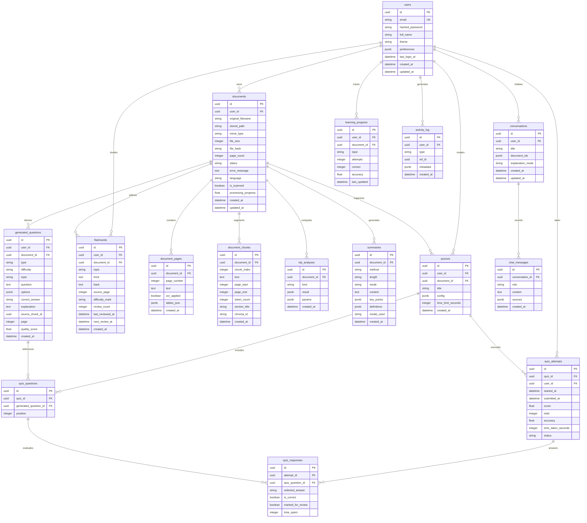

# IntelliDocs AI - Database Architecture & ER Diagram

## 1. Relational Schema Design (PostgreSQL / SQLite)

All tables use UUID primary keys, explicit foreign key constraints with `ON DELETE CASCADE` for data hygiene, and automated timestamp tracking (`created_at`, `updated_at`).

### Entity-Relationship Diagram

---

## 2. Vector Database Integration (ChromaDB)
- **Collection Name**: `chunks`
- **Embedding Dimensions**: 384 (via `all-MiniLM-L6-v2`)
- **Distance Metric**: Cosine Similarity (`hnsw:space=cosine`)
- **Metadata Fields**: `user_id`, `document_id`, `chunk_id`, `page_start`, `page_end`, `chunk_index`
- **Consistency Invariant**: Deleting a document from PostgreSQL cascades to delete all corresponding records from the ChromaDB collection.
